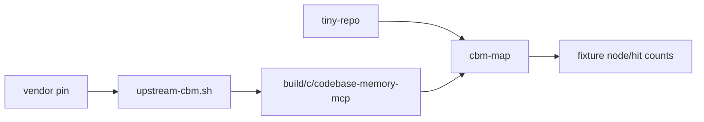

# minilab-codebase-memory-map

**Built by SkilledDragon LLC — architecture-led software engineering — [skilleddragon.com](https://skilleddragon.com)**

Palette: `#020617` / `#040F49` / `#006BDF` / `#00BFA6`

Python (uv/pytest) minilab: pin [DeusData/codebase-memory-mcp](https://github.com/DeusData/codebase-memory-mcp), **source-build** the C binary with the smoke-unix path from upstream `smoke.yml`, run smoke invariants, and map a tiny local fixture into a knowledge graph so long-horizon agent flows can query structure instead of re-walking the tree.

| Piece | Purpose |
| --- | --- |
| `scripts/vendor-upstream.sh` | Clone + pin `vendor/codebase-memory-mcp` (gitignored) |
| `scripts/upstream-cbm.sh` | Verbatim smoke-unix source build + pin-adapted smoke-invariants |
| `scripts/apply-smoke-invariants-pin-fix.py` | Flag-form `index_status`; omit daemon-broken injector vacuity guards |
| `uv run cbm-map` | Index the tiny fixture; print measured node/hit counts |
| `.claude/skills/codebase-memory-map/` | Skill: local map before long-horizon Argon; hedge vendor claims |
| CI | Jobs `lab`, `upstream`, `security` |

Upstream pin: [DeusData/codebase-memory-mcp](https://github.com/DeusData/codebase-memory-mcp) @ `49424722576191a1309d27ec7279c8676d0b1ec2` (short `494247225761`, MIT)

**Claim discipline:** Vendor figures such as 10× / 99% / 120× token savings are **ellos reportan** / **según ellos**. This lab reports only its own measured fixture numbers.

Upstream `.github/workflows/smoke.yml` is **opt-in / non-gating** (`workflow_dispatch` + push to `qa/smoke-**` only). This lab still copies that verified ubuntu smoke-unix source-build path. There is no release-binary or `curl` `install.sh` lab path.

## What we built and why

Long-horizon Gemini / Argon sessions burn tokens re-discovering the same call graph. Upstream codebase-memory-mcp builds a local knowledge graph from tree-sitter (and optional hybrid LSP). This lab freezes a pin, rebuilds from source, proves smoke invariants, and measures a tiny fixture map — local only.



## What we tested

Verified upstream commands at `49424722576191a1309d27ec7279c8676d0b1ec2` (ubuntu smoke-unix from `smoke.yml`):

```bash
sudo apt-get update && sudo apt-get install -y zlib1g-dev python3 git
scripts/build.sh CC=gcc CXX=g++ TEST_SEAMS=1
chmod +x scripts/smoke-invariants.sh
scripts/smoke-invariants.sh build/c/codebase-memory-mcp
```

Lab keyless suite (macOS / any host):

```bash
export DISABLE_TELEMETRY=1 DO_NOT_TRACK=1
uv sync --locked --group dev
uv run ruff check .
uv run ruff format --check .
uv run pytest -q
python3 scripts/check-skills
python3 scripts/check-banned-phrases
python3 scripts/check-upstream-parity
```

Linux source build + smoke-invariants (CI job `upstream`, or a Linux host):

```bash
bash scripts/upstream-cbm.sh
uv run pytest -q tests/test_map_fixture.py
```

Pass counts and tool versions: [RESULTS.md](RESULTS.md).

## Setup

Requires Python `>=3.10` (CI uses 3.12), [uv](https://docs.astral.sh/uv/), `gcc`/`g++`, and zlib headers (Linux: `zlib1g-dev` via the upstream script).

```bash
git clone https://github.com/SkilledDragonCorp/minilab-codebase-memory-map.git
cd minilab-codebase-memory-map
cp .env.example .env
uv sync --locked --group dev
bash scripts/vendor-upstream.sh
```

Confirm the vendor pin:

```bash
git -C vendor/codebase-memory-mcp rev-parse HEAD
# must print 49424722576191a1309d27ec7279c8676d0b1ec2
```

Optional pre-commit (gitleaks `v8.30.1`):

```bash
uv run pre-commit install
```

## Tutorial

1. Source-build + smoke invariants:

```bash
bash scripts/upstream-cbm.sh
```

2. Map the tiny fixture (measured lab numbers only):

```bash
uv run cbm-map tests/fixtures/tiny-repo --json
```

3. Read the skill for local-map workflow and hedge rules:

`.claude/skills/codebase-memory-map/SKILL.md`

## Claude Code / Cursor skills

Installable skill path (canonical only):

- `.claude/skills/codebase-memory-map/SKILL.md`

Do not add `.cursor/skills` or `.agents/skills` mirrors. CI enforces layout + frontmatter.

## Security / Defender note

See [SECURITY.md](SECURITY.md). Neutral summary: upstream documents a Microsoft Defender false-positive class on some **release** artifacts; verify via their [SECURITY.md](https://github.com/DeusData/codebase-memory-mcp/blob/49424722576191a1309d27ec7279c8676d0b1ec2/SECURITY.md). This lab builds from source at the pin.

## Telemetry

Upstream states indexing / graph / MCP tool handling run locally without uploading source for those paths, with a best-effort GitHub release update check after MCP `initialize`. Lab runs set `DISABLE_TELEMETRY=1` and `DO_NOT_TRACK=1`. Keep maps local.

## License

MIT. Upstream `DeusData/codebase-memory-mcp` is MIT at the pin.
